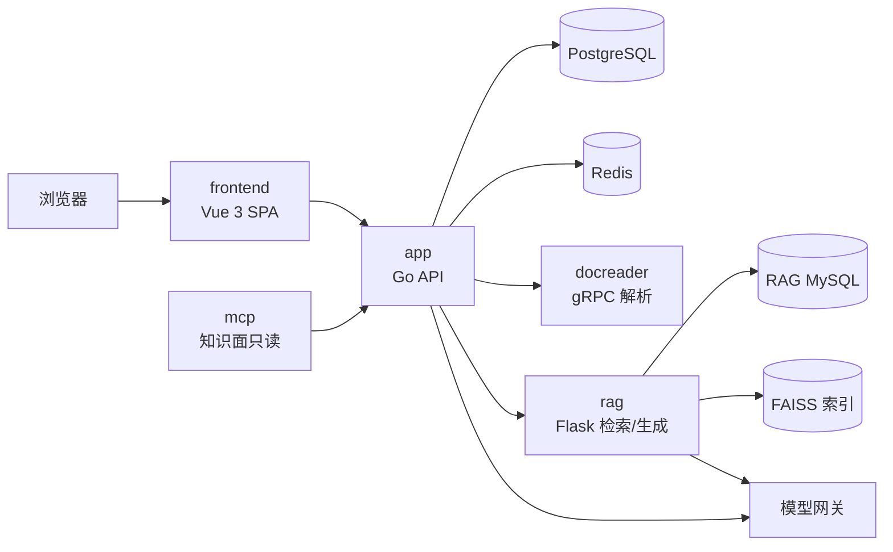

# WellRead Personal

单 owner、本地部署的个人知识库与阅读助手。导入文档/代码，基于自己的知识库问答并查看引用，进入交互式精读，维护个人技能，通过 MCP 把只读知识能力接入外部 AI 客户端。数据留在本机，不依赖外部 SaaS。

## 1. 定位与边界

- **做**：多知识库、文档/网页/手工/代码项目入库、检索问答与引用、交互式精读、个人技能、单 MCP Key（知识面只读）、模型/解析/存储/提示词设置、健康与队列。
- **不做**：注册、邀请、OIDC、多账号、部门、角色、能力契约、共享空间、ACL、协作 CR、治理台、审计导出、多租户 SaaS。
- **安全边界**：只有一个 owner；后端是唯一授权边界；MCP 使用单 Key（知识面只读）；密钥只来自环境变量。

## 2. 核心能力

| 层 | 能力 | 价值 |
|---|---|---|
| 知识生产 | 上传/网页/手工/代码项目、解析、分块、文件夹、标签、版本、归档与回收站 | 自己的资料可维护、可追溯 |
| 知识消费 | 混合检索、带引用问答、精读工作台、报告导出 | 找得到、答得准、读得深 |
| 学习闭环 | 学习/复习回答模板、自测题保存、持久复习卡、自适应间隔重复与复习会话；V3 四档评分、漏洞热力图、独立簇页与 AI 补强已完成并切换主路由，真实数据/真实 LLM 冒烟通过 | 学过的东西能记住、弱项能定位 |
| 个人化 | 个人技能、全局系统提示词、模型/解析/存储设置 | 按自己的习惯使用 |
| 外部接入 | 单 API Key（知识面只读）、17 个 MCP 工具、CLI | 接入外部 AI 客户端 |
| 运维 | 健康检查、运行时队列、增量迁移、本地数据备份 | 能部署、能排障 |



## 3. 服务地图

| 目录 | 生态位 | 职责 |
|---|---|---|
| `app/` | Go 后端 | API、认证、知识库/文档、会话、精读、技能、设置、docreader、CLI、Go SDK、Swagger |
| `frontend/` | Vue 3 + Vite + TDesign | 问答、知识库、精读、复习、技能、设置；全前端统一 TDesign，复习 V3（今日/卡片/统计/生成/对等能力）已完成，V2 与 shadcn 已删除；`design/` 为设计源 |
| `rag/` | Flask 侧车 | App 分块的嵌入/索引、混合检索、重排、生成 |
| `mcp/` | MCP 接入层 | 单 Key（知识面只读）暴露 17 个 MCP 工具 |
| `deployments/` | 部署 | 六服务 compose、hotreload overlay、systemd、env example |
| `scripts/` | 跨服务脚本 | 构建镜像、Lite 打包、环境检查、数据导入 |
| `docs/` | 文档 | 总览、需求与设计、进度、历史归档、演示 |

## 4. 快速开始

```bash
cp deployments/.env.example deployments/.env
# 必填：DB_PASSWORD、JWT_SECRET、SYSTEM_AES_KEY、OWNER_EMAIL、OWNER_PASSWORD、模型密钥
mkdir -p data/rag/models    # 仅在本地 BGE 后端时需要放入模型
docker compose -f deployments/docker-compose.yml up -d --build
```

访问：

- 前端：`http://localhost:6151`
- 后端健康：`http://localhost:6152/health`
- Swagger（非 release）：`http://localhost:6152/swagger/index.html`

首次启动会用 `OWNER_EMAIL` / `OWNER_PASSWORD` 创建唯一 owner；两个变量缺失或密码不合规时服务启动失败。个人版要求全新数据库，旧企业库不能原地升级。

## 5. 工程约定

- 迁移策略：`000000_init` 为冻结基线，新表/列按顺序新增 `000001_*` 等增量迁移；PostgreSQL 与 SQLite 各一份。
- RAG 不负责解析/分块：`/ingest` 必须携带 App 生成的 chunks；RAG 负责索引、检索、重排与 RAG 模式答案生成。
- MCP 知识面只读：17 个工具；会话面仅自有会话（创建/读取/列表/删除）；知识写入、模型、租户与共享空间工具已删除。
- 前端共享壳层与六分区设置：`/` Notion 极简落地页，左栏首页/问答/知识库/精读/复习/技能，右栏设置/主题/帮助，设置作为普通详情页；落地页含平台/RAG 可交互架构图；没有能力契约或角色 if-else。
- 本地数据 `data/rag/` 不进入 git、镜像或备份仓库；上传文件在 `data-files` 卷。

## 6. 常用命令

```bash
make up / down / restart / ps / logs
make dev / dev-logs / dev-stop
make test-app / test-frontend / test-rag / test-mcp / test
make images / package-lite
make migrate-up / migrate-down
make health
```

前端开发：`cd frontend && npm run dev`，`/api` 代理到 6152。
RAG 语法检查：`cd rag && python -m compileall -q src`。
MCP 测试：`cd mcp && uv sync --extra test && uv run pytest -q`。
Windows 本机后端可能因 duckdb/gjieba CGO 失败；完整测试以 Linux 容器为准。

## 7. 文档

| 文档 | 内容 |
|---|---|
| [系统总览](docs/01-项目总览/系统总览.md) | 服务生态、身份、核心链路、数据归属 |
| [术语与约定](docs/01-项目总览/术语与约定.md) | 术语、文档规范、路径与安全约定 |
| [知识库与文档管理](docs/02-需求与设计/02-知识库/知识库与文档管理.md) | 入库、解析、版本、归档与回收站 |
| [问答与引用](docs/02-需求与设计/01-问答/问答与引用.md) | 检索范围、引用、会话 |
| [学习场景与RAG](docs/02-需求与设计/01-问答/学习场景与RAG.md) | 学习资料、代码入库、检索与引用边界 |
| [复习卡与间隔重复](docs/02-需求与设计/04-复习/复习卡与间隔重复.md) | 卡组、查重吸收、四档调度与漏洞闭环（V3 已完成，V2 剩余能力已移植并清理） |
| [复习页设计](docs/02-需求与设计/04-复习/复习页设计.md) | 复习页结构、交互、视觉与组件映射 |
| [交互式精读](docs/02-需求与设计/03-精读/交互式精读.md) | 阅读计划、工作台、笔记、报告 |
| [精读agent需求](docs/02-需求与设计/03-精读/精读agent/精读agent需求.md) / [开发方案](docs/02-需求与设计/03-精读/精读agent/精读agent开发方案.md) | 四段流水线、单交互点、记忆、自测出卡与双模型分层 |
| [落地页设计](docs/02-需求与设计/05-落地页/落地页设计.md) | 首页结构、文案约束、token、动效与验收 |
| [技能与问答注入](docs/02-需求与设计/01-问答/技能与问答注入.md) | 技能目录与注入规则 |
| [界面规范](docs/02-需求与设计/00-通用与界面/界面规范.md) | 导航、设置分区、交互约定 |
| [个人版账号与访问](docs/02-需求与设计/00-通用与界面/个人版账号与访问.md) | owner、登录、单 Key（知识面只读） |
| [架构决策](docs/06-架构决策/) | 迁移基线、TDesign 组件路线、复习调度与卡片身份等长期决策 |
| [当前进度](docs/03-进度与交接/当前进度.md) | 阶段、待办、验证基线、风险 |
| [验证记录](docs/03-进度与交接/验证记录.md) | 历史部署、验证与已完成批次流水 |
| [演示指南](docs/05-演示与试用/演示指南.md) / [常见问题](docs/05-演示与试用/常见问题.md) | 演示流程与排障 |
| [部署手册](deployments/README.md) | compose、环境变量、备份升级 |
| [app](app/README.md) / [frontend](frontend/README.md) / [RAG](rag/README.md) / [MCP](mcp/README.md) | 子系统入口 |

个人版改造规划文档归档在 [docs/04-历史归档/个人版改造规划/](docs/04-历史归档/个人版改造规划/)，只作追溯，不代表当前实现。

## License

见 `app/LICENSE` 与各子系统许可说明。
