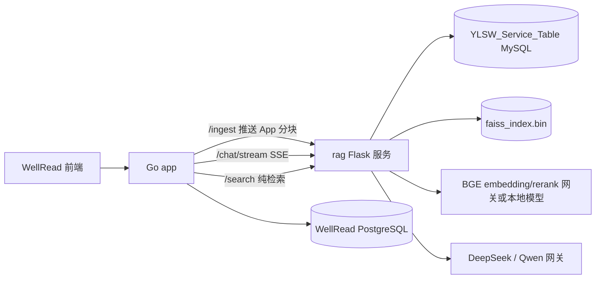

# WellRead RAG 检索引擎

`rag/` 是 WellRead Personal 的检索与生成侧车（容器名 `ylsw`）：接收 Go 后端推送的分块和用户问题，完成嵌入、向量/BM25 混合召回、RRF 融合、精排、上下文组装与答案生成。它不管理用户、知识库权限、文档解析、分块或文档生命周期，这些属于 `app/`。

## 模块生态位



| 层 | 归属 |
|---|---|
| 文档、知识库、解析、分块、OCR、元数据、用户与设置 | `app/` |
| 向量/BM25 索引、检索融合、重排、答案生成 | `rag/` |
| BGE 模型、FAISS 索引 | 仓库内 `data/rag/`（gitignore） |

## 快速开始

推荐从仓库根使用 app 栈；RAG 作为 `ylsw` 侧车运行：

```bash
cp deployments/.env.example deployments/.env
# 填写 YLSW_MYSQL_*、YLSW_ENGINE_TOKEN、BGE/LLM key
docker compose -f deployments/docker-compose.yml up -d --build ylsw
docker logs -f Gaze-ylsw
```

独立调试可只用 `rag/docker-compose.yml`，但它不是个人版主部署路径：

```bash
cd rag
cp .env.example .env
# 填写 MYSQL_PASSWORD 与模型 key
docker compose -f docker-compose.yml -f docker-compose.local.yml up -d --build
curl http://localhost:6151/health
```

环境变量、数据目录与故障排查见[部署与运维](docs/部署与运维.md)。

## 代码地图

| 路径 | 作用 |
|---|---|
| `src/app.py` | Flask API、问答编排、SSE、图片占位符、引用组装 |
| `src/retrieval/` | 查询规划、FAISS、BM25、RRF、精排、内存 chunk 镜像 |
| `src/ingest/` | 嵌入、MySQL 写入、FAISS 构建与重嵌辅助 |
| `src/llm/` | 提示词组装、答案生成、多步综合 |
| `src/prompts/` | 学习/复习/代码等提示词模板 |
| `src/config.py` | 环境变量、路径、检索与超时参数 |
| `src/server_bench.py` | 模型/端到端基准脚本 |
| `init.sql` | MySQL 表结构 |
| `entrypoint.sh` | 等 MySQL、建表、准备数据目录、建空索引、预热、启动 API |
| `rebuild_faiss.py` | 全量重建 FAISS 索引 |
| `test/` | 冒烟、接口、E2E、性能与历史质量评测 |

## 文档地图

| 文档 | 内容 |
|---|---|
| [系统架构](docs/系统架构.md) | 组件、数据流、存储、设计取舍 |
| [检索与生成](docs/检索与生成.md) | 规划、双路召回、RRF、精排、上下文、生成与引用 |
| [数据入库与索引](docs/数据入库与索引.md) | App 分块契约、MySQL/FAISS、删除与重建 |
| [接口与集成](docs/接口与集成.md) | app → rag 的 API、SSE、鉴权、幂等与对账 |
| [部署与运维](docs/部署与运维.md) | 环境变量、启动、清库重建、索引维护、故障排查 |
| [测试与评测](docs/测试与评测.md) | 历史评测结果、复现方式与当前测试入口 |

## 测试结果速览（历史）

以下数据来自 2026-09 的企业期四路召回版本，当前个人版已改为向量 + BM25 双路；数字只作为检索算法参考，不代表当前基线：

- Stage 1：串行 50 题端到端均值约 3.35s，并发 60 时 QPS 约 9.8。
- Stage 2：重排后 Recall@10 = 0.936，混合检索 MRR = 0.940。
- Stage 3：修复记录答案正确率 92.5%（111/120）。

完整图表与口径见[测试与评测](docs/测试与评测.md)。

## 边界

- 模型、索引不进入仓库，必须通过 `RAG_DATA_DIR` / `LOCAL_MODELS_DIR` 或挂载提供；当前个人版不扫描 `Data/` 语料。
- `/ingest` 必须携带 App 生成的分块；RAG 不做文件解析、分块或元数据抽取。
- RAG 不接收 ACL、部门、密级或角色参数；范围过滤只使用知识库/文档白名单。
- 服务间鉴权用 `YLSW_ENGINE_TOKEN`；生产环境不要直接暴露 RAG 端口到公网。
- 修改分块或 embedding 来源后必须重建索引；旧 FAISS 向量不会自动删除。
