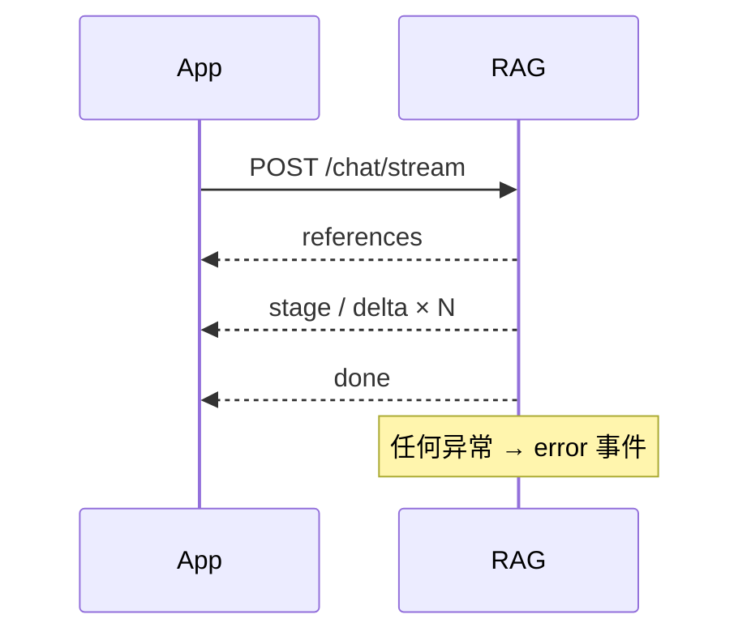
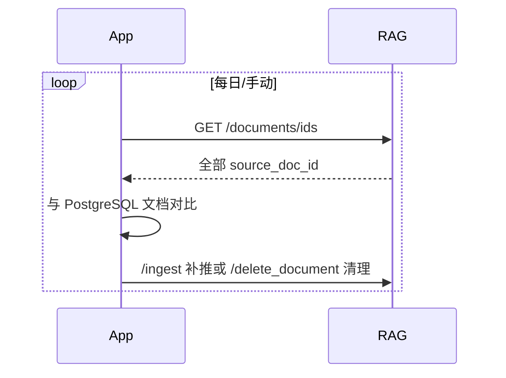

# 接口与集成

本文描述 `app/` 与 `rag/` 之间的接口契约、鉴权、SSE 事件和幂等/对账规则。算法链路见[检索与生成](检索与生成.md)。

## 1. 鉴权

- 配置 `YLSW_ENGINE_TOKEN` 后，除 `/health` 外所有请求必须带 `X-Engine-Token`。
- 缺少或错误返回 401：`{"error":"invalid or missing X-Engine-Token"}`。
- 未配置 token 时跳过校验，仅用于本地开发；生产必须配置。
- RAG 端口不直接暴露公网；app 通过 compose 内网访问。

## 2. 接口总览

| 方法 | 路径 | 用途 |
|---|---|---|
| POST | `/chat` | 非流式问答，返回 `{answer}`，可带 `timings`/`trace` |
| POST | `/chat/stream` | SSE 问答，app 融合链路使用 |
| POST | `/search` | 纯检索，无生成，供 Agent `knowledge_search` |
| POST | `/ingest` | App 推送文档与分块 |
| POST | `/delete_document` | 按 App `document_id` 删除文档 |
| POST | `/update_metadata` | 原地更新生命周期元数据，不重嵌入 |
| GET | `/documents/ids` | 对账：返回全部 `source_doc_id` |
| GET | `/index/status` | 索引健康：向量/分块/pending/failed |
| GET | `/health` | 健康检查 |

## 3. `/chat`

请求：

```json
{
  "question": "这一章的核心结论是什么？",
  "knowledge_base_ids": ["kb-uuid"],
  "answer_mode": "study",
  "skill": {
    "id": "skill-id",
    "name": "对比阅读",
    "version": "3",
    "content_hash": "sha256",
    "instructions": "先列共同点，再列差异"
  },
  "include_expired": false,
  "timing": true,
  "trace": true
}
```

- `question` 必填；空问题返回提示。
- `knowledge_base_id` 与 `knowledge_base_ids` 二选一；同时传入时单值优先；空表示全库检索。
- `answer_mode`：`study` / `review` / `code`，默认 `study`。
- `skill.instructions` 最多 32000 字符；为空或超限时跳过注入。
- `timing`/`trace` 用于评测；生产可关闭。

响应：

```json
{
  "answer": "...",
  "timings": {"规划改写": 800, "精排rerank": 1000, "总计": 3300},
  "trace": {"query_type": "single", "faiss_hits": [], "reranked": []}
}
```

## 4. `/chat/stream`

SSE 事件（每行 `data: {json}`）：

| `type` | 载荷 | 说明 |
|---|---|---|
| `references` | `references: [YLSWReference]` | 检索完成先发；断流兜底时也会补发 |
| `stage` | `stage/t_ms/counts/detail` | 阶段进度，可选 |
| `delta` | `content` | 答案增量，图片占位符已替换 |
| `done` | `references` | 结束，携带最终引用 |
| `error` | `message` | 错误，终止流 |

`YLSWReference` 包含：`chunk_id`、`app_chunk_id`、`document_id`、`source_doc_id`、`knowledge_base_id`、`file_name`、`doc_number`、`org_name`、`doc_type`、`product_name`、`doc_title`、`content`（≤400 字）、`doc_date`、`lifecycle_status`、`source`、`rerank_score`。



## 5. `/search`

请求：

```json
{
  "queries": ["问题一", "问题二"],
  "knowledge_base_ids": ["kb-uuid"],
  "document_ids": ["app-doc-uuid"],
  "top_k": 10,
  "include_expired": false
}
```

- 纯检索，不生成答案；多查询结果按 `chunk_id` 去重取最高精排分。
- `knowledge_base_ids` 为空表示全库；`document_ids` 为空表示不按文档过滤。
- 返回：

```json
{
  "results": [{
    "chunk_id": "12",
    "app_chunk_id": "chunk-uuid",
    "document_id": "3",
    "source_doc_id": "app-doc-uuid",
    "file_name": "chapter-1.md",
    "content": "...",
    "score": 0.82,
    "rerank_score": 0.91,
    "org_name": "",
    "doc_type": "",
    "product_name": "",
    "doc_number": "",
    "doc_date": "",
    "source": "faiss"
  }]
}
```

## 6. `/ingest`

请求关键字段：

| 字段 | 必填 | 说明 |
|---|---|---|
| `knowledge_base_id` | 是 | App 知识库 UUID |
| `document_id` | 是 | App 文档 UUID，幂等键 |
| `file_name` / `file_type` | 是 | 文件名/类型 |
| `markdown` | 是 | App 拼好的正文，用于大小统计与兼容 |
| `chunks` | 是 | App 生成的分块数组；为空直接 400 |
| `doc_title` / `doc_number` / `org_name` / `doc_date` / `doc_type` / `product_name` | 否 | 文档属性 |
| `lifecycle_status` / `effective_date` / `expiry_date` / `superseded_by` | 否 | 兼容字段 |
| `custom_metadata` | 否 | 受控 KV |

分块字段见[数据入库与索引](数据入库与索引.md) §3。

返回：

```json
{"status":"success","document_id":"app-doc-uuid","doc_id":12,"chunks":37,"embedded":37}
```

重复推送同一 `document_id` 会在事务内替换旧版本；嵌入失败返回 500 并将文档标为 `failed`。

## 7. 删除、元数据与对账

### `/delete_document`

```json
{"document_id": "app-doc-uuid"}
```

返回 `{"deleted":1,"document_id":"..."}` 或 `deleted:0`。MySQL 级联清分块；FAISS 残留由检索过滤。

### `/update_metadata`

```json
{
  "document_id": "app-doc-uuid",
  "lifecycle_status": "effective",
  "effective_date": "2026-01-01",
  "expiry_date": "",
  "superseded_by": ""
}
```

返回 `{"updated":1}` 或 `updated:0`；不重切分、不重嵌入。

### `/documents/ids`

返回 `{"ids":["app-doc-uuid", ...]}`，供 app 双向对账：App 有而 RAG 无 → 重新推送；RAG 有而 App 无 → 删除。



## 8. 错误语义

| HTTP | 场景 |
|---|---|
| 400 | 必填字段缺失、`chunks` 为空 |
| 401 | `X-Engine-Token` 缺失/错误 |
| 500 | 入库、嵌入或生成异常 |
| 200 + 空结果 | 检索无命中；不是错误 |

检索/生成超时不返回统一业务码；调用方应结合 HTTP 状态、`error` 事件和超时预算处理。

## 9. 超时预算

| 阶段 | 超时 |
|---|---|
| Planner 快试/救援 | 5s / 5s |
| Rerank | 5s |
| Generate | 20s（模板模式 45–90s） |
| Keepalive | 480s 间隔 |

Planner 挂起回退单步检索；精排挂起回退 RRF；生成超时该题失败。详见[部署与运维](部署与运维.md)。

## 10. 安全要点

- 服务间只用 `YLSW_ENGINE_TOKEN`；token 不进前端。
- RAG 不接收 ACL、部门、密级或角色参数；知识库/文档白名单由 App 传入。
- `/ingest` 的 `knowledge_base_id`/`document_id` 由 App 生成，RAG 不信任外部客户端任意值做越权写入。
- 生产只在内网暴露 RAG 端口。
