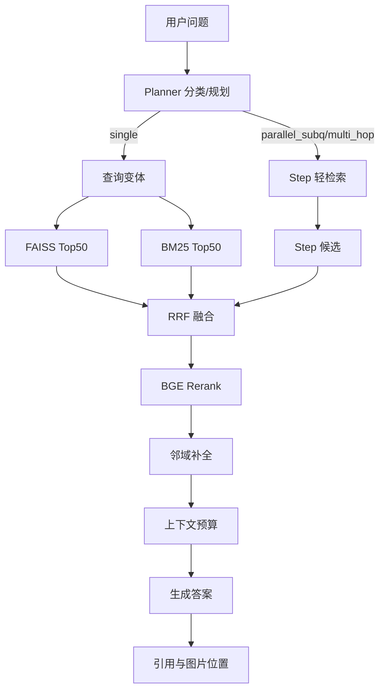

# 检索与生成

本文描述从问题到答案引用的完整链路：规划、向量/BM25 双路召回、RRF 融合、精排、上下文组装、生成与引用。系统组件见[系统架构](系统架构.md)，历史评测数据见[测试与评测](测试与评测.md)。

## 1. 总体链路

RAG 只做两路召回：向量与 BM25。元数据精确匹配、Text-to-SQL 与权限过滤已从当前链路移除；知识库/文档白名单是唯一的范围过滤。

## 2. 查询理解

### 2.1 规划器

`planner.py` 将问题分类为：

| 类型 | 处理 |
|---|---|
| `single` | 单步问题，并行两路检索；可生成查询变体 |
| `parallel_subq` | 多个子问题并行轻检索，最后综合 |
| `multi_hop` | 串行多跳，前一步结果作为后一步上下文 |

规划器输出 JSON，经 `_validate_plan` 校验；LLM 超时或非法 JSON 回退单步检索。`generate_query_variants` 生成语义变体，扩大召回面。

### 2.2 异常问题

- 提示词注入/明显无关问题由 planner 判定拒答，返回固定文案。
- 闲聊走简短回复，不进入知识检索。
- 拒答不产生引用；SSE 仍按正常事件顺序结束。

### 2.3 轻检索

多步计划的每个 step 用 `faiss + bm25` 轻量召回后做 RRF，取 `STEP_TOP_K=12` 条。`foreach` step 对依赖项展开，最多 4 项并行。

## 3. 双路召回

### FAISS 向量路

- BGE-M3 embedding，1024 维截断到 768 维。
- HNSW：`M=32`，`ef_search=192`，`FAISS_TOP_K=50`。
- 多查询变体分别检索后按 `vector_id` 去重取最高分。
- embedding 可走网关或本地模型；切换来源必须重建索引。

### BM25 关键字路

- jieba 分词 + BM25Okapi，`k1=1.5`、`b=0.75`。
- 与 FAISS 对称 `BM25_TOP_K=50`。
- 文号、版本、路径、符号名等词面信号由 BM25 补足。

### 图片块

- App 可推送 `chunk_type=image` 的分块，携带 `image_url`、`image_caption`、`image_ocr` 与父文本分块 ID。
- 图片块与文本块一起召回；生产只使用 caption/OCR 文本，不把图片本体传给生成模型。
- 命中的图片通过 `[[IMG:n]]` 占位符进入答案，流式输出时替换为 `resource://` 链接。

## 4. RRF 融合

- 两路候选按 `chunk_id` 去重，按 RRF（`k=60`）融合；同一 chunk 多路命中时分数相加。
- `_select_diverse` 控制同文档/相邻文档过度聚集。
- 融合后按知识库白名单过滤；`/search` 还可按文档 ID 过滤。
- 不再做 `acl_scope`、部门、密级过滤。

## 5. 精排

- BGE-Reranker 对候选打分；每源最多 `RERANK_MAX_CANDIDATES_PER_SOURCE=100`。
- 最终取 `FINAL_TOP_K=10`，并留补位余量。
- 多步题对原问题和各 step query 多路打分取最大值，防止第二问被稀释。
- 精排超时/失败回退 RRF 顺序。
- 最高精排分低于 `ANSWER_MIN_RERANK_SCORE=0.05` 时视为没有可用证据，返回零命中提示而不是硬答。

## 6. 生命周期与上下文

### 生命周期

- `_apply_lifecycle` 仍会识别 `lifecycle_status=expired` 并降权；个人版 App 不维护生效/废止日期，字段默认为 `effective`，该逻辑在当前产品中不生效。
- `include_expired=true` 可关闭过期过滤，仅用于兼容旧数据与评测。

### 邻域补全

- 入选 chunk 的同文档相邻块按融合顺序补入尾部，缓解细节题答案落在相邻块的问题。
- 同文档多版本召回只保留最新版本。

### 上下文组装

- RAG 不生成 parent 分块；App 分块以 child 单元入库。
- 当前上下文由 child 文本组装：同一文档、位置重叠或相邻的入选块合并为一条，跨章节不合并。
- 若旧库存在 parent 行，`chunk_store` 会优先使用 parent 文本；这是兼容路径，不是当前 App 入库路径。
- 学习/复习/代码三种回答模式有独立上下文预算与输出预算，见第 9 节。

## 7. 生成

`generator.py` 负责：

- 按 `answer_mode`（`study` / `review` / `code`）选择模板与预算。
- 注入 App 传来的技能提示词；技能只在普通问答生效，精读不使用。
- 资料不足时先答已有内容并标注缺失；检索零命中时返回固定提示，不生成完整卡片。
- 学习/复习模板要求结构化标题、分点、表格、公式与必要的 Mermaid。
- 代码回答可在正文带 `path:line` 定位。

## 8. 引用与图片

`_build_refs` 将精排结果转成 app 期望的引用结构：

- `chunk_id` 字符串化，附 `app_chunk_id`、`document_id`、`source_doc_id`、`knowledge_base_id`。
- 文件、文号、机构、类型、产品、日期与生命周期字段。
- 正文摘要最多 400 字，供前端引用卡悬浮展示。
- 图片块不生成引用；图片通过答案内嵌链接展示。
- 引用只来自精排结果，不由客户端拼造。

## 9. 参数与预算

| 参数 | 默认 | 作用 |
|---|---|---|
| `FAISS_TOP_K` / `BM25_TOP_K` | 50 / 50 | 两路候选 |
| `RRF_K` | 60 | RRF 融合常数 |
| `FINAL_TOP_K` | 10 | 送入 LLM 的 chunk 数 |
| `RERANK_MAX_CANDIDATES_PER_SOURCE` | 100 | 每源精排候选上限 |
| `STEP_FAISS_K` / `STEP_TOP_K` | 30 / 12 | 多步计划单步轻检索 |
| `ANSWER_MODE_BUDGETS` | study 6000/1500/90s · review 3000/650/45s · code 8000/800/90s | 上下文/输出/超时 |
| `MAX_CONTEXT_CHARS` | 8000 | 非模板路径上下文预算 |
| `PLANNER_TIMEOUT` / `RERANK_TIMEOUT` / `GENERATE_TIMEOUT` | 5 / 5 / 20s | 分段预算 |

## 10. 失败模式

| 现象 | 根因 | 处理 |
|---|---|---|
| 有答案却“未找到” | 精排分低于证据阈值 | 放宽 `ANSWER_MIN_RERANK_SCORE` 或检查召回 |
| 多步第二问被稀释 | 只按原问题精排 | 多路 query 打分取最大值 |
| 邻域细节缺失 | 答案在相邻块 | 邻域补全 |
| 图片不显示 | 占位符越界或 URL 不在候选清单 | 越界编号直接删除；只替换候选图片 |
| 精排后首位下降 | 强词面候选被其他高分取代 | 接受 Top-3+ 增益，必要时调整 rerank |
| 检索为空 | 文档未入库、索引缺失、KB 过滤过窄 | 检查 `/ingest`、`/index/status`、`kb_ids` |
