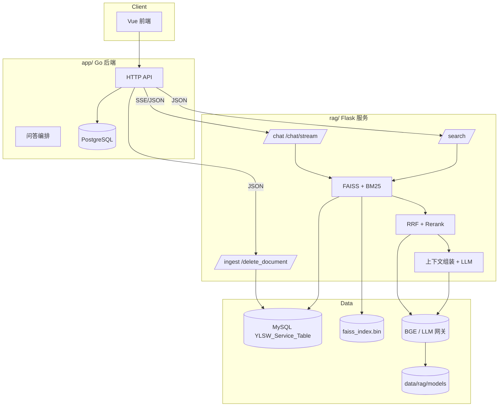
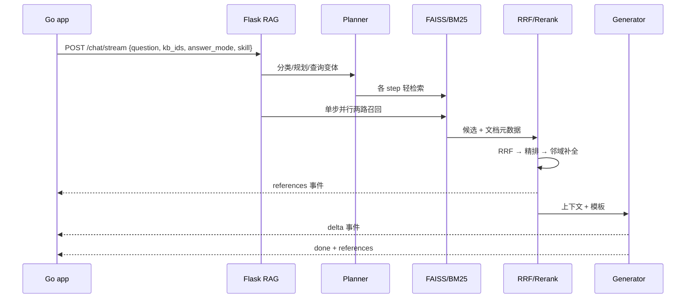
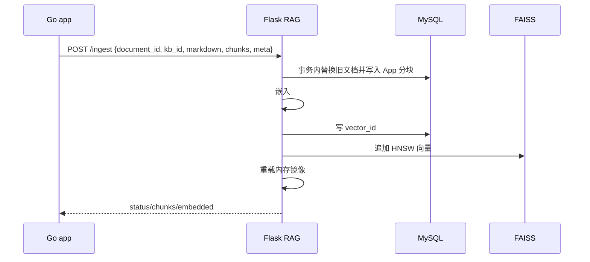

# 系统架构

本文描述 RAG 服务的定位、运行时组件、数据存储和关键设计取舍。检索算法见[检索与生成](检索与生成.md)，入库见[数据入库与索引](数据入库与索引.md)。

## 1. 定位与边界

RAG（容器名 `ylsw`）是 WellRead Personal 的检索与生成侧车，不是文档管理系统。

| 关注点 | 归属 |
|---|---|
| 用户、知识库、文档生命周期、解析、分块、OCR、标签、设置 | `app/`（Go） |
| 嵌入、向量/BM25 索引、召回、融合、精排、上下文组装、答案生成 | `rag/` |
| BGE 模型、FAISS 索引 | 仓库内 `data/rag/`（gitignore） |

App 通过 `/ingest` 推送已生成的分块，RAG 只做索引与检索；RAG 不重新解析文件、不分块、不抽元数据，也不接收权限过滤参数。个人版只有一个 owner，检索范围只由知识库与文档白名单决定。

## 2. 运行时拓扑

compose 中 RAG 只暴露内网端口 5000；宿主机默认只发布 frontend 6151 与 app 6152。

## 3. 代码组件

| 文件/目录 | 职责 |
|---|---|
| `src/app.py` | Flask 路由、问答编排、SSE、图片占位符替换、引用组装 |
| `src/config.py` | 环境变量、路径、检索参数、超时预算 |
| `src/retrieval/planner.py` | 问题分类、单步/并行/多跳计划、查询变体、轻检索 |
| `src/retrieval/faiss_search.py` | BGE embedding、HNSW 向量检索 |
| `src/retrieval/bm25_search.py` | jieba 分词、BM25 关键字检索 |
| `src/retrieval/fusion.py` | RRF 融合、去重、多样性、精排 |
| `src/retrieval/chunk_store.py` | 内存 chunk/文档元数据映射、BM25 语料、图片关联 |
| `src/llm/generator.py` | 提示词组装、答案生成、多步综合 |
| `src/ingest/pipeline.py` | 嵌入、MySQL 写入、FAISS 构建与重嵌辅助 |
| `src/prompts/` | 学习/复习/代码等回答模板 |
| `src/models_singleton.py` | 本地 BGE 模型单例 |
| `src/prompt_guard.py` | 提示词注入防护与拒答文案 |
| `src/trace_logging.py` | 检索链 trace |
| `entrypoint.sh` | 等 MySQL、建表、准备数据目录、建空索引、预热模型、启动 API |

## 4. 数据存储

### MySQL

| 表 | 状态 | 用途 |
|---|---|---|
| `documents` | 使用中 | App 文档镜像：来源 ID、知识库、文件名、解析状态 |
| `chunks` | 使用中 | App 分块镜像、FAISS `vector_id`、文本/图片字段 |
| `parse_log` | 使用中 | 入库阶段日志 |
| `chunk_embedding_cache` | 历史残留 | 旧向量缓存；当前无读写 |

旧版表格/产品检索表（`tables_structured`、`schema_registry`、`product_mentions`）已从 `init.sql` 与代码中移除：新环境不再创建，已有库中的旧表不再被读写，可按需手工删除。

`documents` / `chunks` 仍保留生命周期与产品/机构字段，用于兼容旧数据和引用展示；个人版 App 不维护生效/废止日期，`lifecycle_status` 默认 `effective`。

### FAISS

- HNSW，`EMBEDDING_DIM=768`，`M=32`，`ef_search=192`。
- `faiss_index.bin` 位于 `RAG_DATA_DIR` 的父目录；compose 挂载到 `/app/external`。
- HNSW 不支持物理删除；删除文档后靠 `vector_id` 映射过滤，物理清理用 `rebuild_faiss.py`。

### 内存态

启动时加载 child chunk、文档元数据、BM25 语料和图片映射；`/ingest` 或 `/delete_document` 成功后重载内存镜像。

## 5. 请求生命周期

### 问答

### 入库

嵌入失败时文档标记 `failed`，不标记 `success`；App 重新推送即可重试。

## 6. 失败与降级

- 规划器超时/非法 JSON：回退单步并行检索。
- 查询变体失败：只用原问题检索。
- 精排失败/超时：回退 RRF 顺序，不阻断问答。
- 生成失败：该题返回错误，没有规则兜底答案。
- 嵌入失败：整篇文档标记 `failed`；后台重嵌 daemon 可重试 pending 分块。
- 文档删除后 FAISS 残留：检索层通过映射过滤，`rebuild_faiss.py` 物理重建。
- SSE 发送端中断：流结束，后台线程不继续写数据库。

## 7. 可观测性

- `timing: true` 返回规划、召回、融合、精排、生成等阶段耗时。
- `trace: true` 返回检索中间候选，评测脚本使用。
- 日志包含 `kb_ids`、规划改写、两路候选数量、精排 top、引用文件。
- `/health` 返回 `{"status":"ok"}`；`/index/status` 返回向量/文档/分块与 pending 数。
- `src/server_bench.py` 提供模型与端到端基准命令。

## 8. 关键设计取舍

| 选择 | 原因 | 代价 |
|---|---|---|
| RAG 独立 MySQL，而非直接读 app PostgreSQL | 索引字段、FAISS 映射与业务库解耦 | 依赖 `/ingest` 同步与 reconcile |
| App 分块直传，RAG 不再解析 | 解析/OCR/分块只需维护一套 | 旧离线语料必须走 App 或专门脚本 |
| `knowledge_base_id` 反范式到 chunks | 检索过滤免 JOIN | 文档换知识库时需要重推 |
| 向量 + BM25 混合 + RRF + 精排 | 单路召回不稳定，混合显著提升排序 | 精排增加约 1s 延迟 |
| 本地模型目录 | 模型体积大，不进入 git/镜像 | 部署必须正确挂载 |
| SSE 聚合后交给 MCP/客户端 | 与 app 流式协议对齐 | MCP 侧不是增量输出 |
