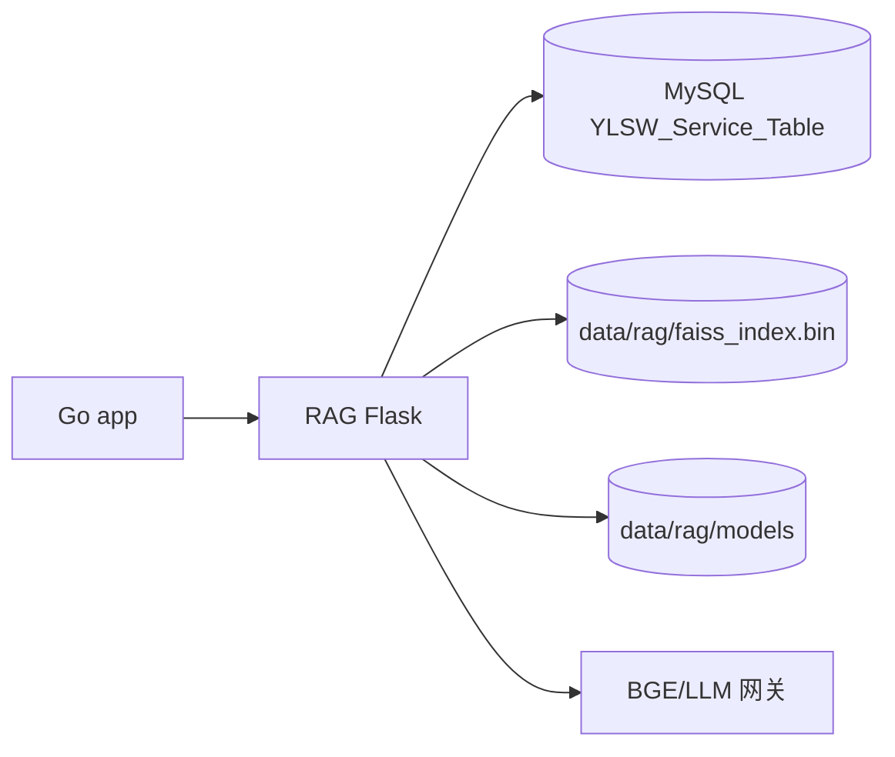

# 部署与运维

本文覆盖 RAG 的部署拓扑、环境变量、数据目录、启动管线、清库重建、索引维护与故障排查。服务边界见[系统架构](系统架构.md)。

## 1. 运行形态

RAG 作为 app 栈的 `ylsw` 侧车运行，容器名 `Gaze-ylsw`：

- App 通过 `/chat/stream`、`/search`、`/ingest` 调用。
- MySQL 保存文档/分块镜像，FAISS 保存向量索引。
- BGE 模型与 `faiss_index.bin` 在仓库内 `data/rag/`（gitignore）。
- 宿主机默认只发布 frontend 6151 与 app 6152；RAG 只在 Docker 内网 `expose 5000`。



## 2. 推荐部署：仓库 compose

```bash
cd WellRead
cp deployments/.env.example deployments/.env
# 填写 DB、YLSW_MYSQL_*、OWNER_*、JWT_SECRET、SYSTEM_AES_KEY、BGE/LLM key
mkdir -p data/rag/models        # 仅在本地 BGE 后端时需要放入模型
docker compose -f deployments/docker-compose.yml up -d --build
```

compose 固定：

```text
../data/rag:/app/external
RAG_DATA_DIR=/app/external/Data
LOCAL_MODELS_DIR=/app/external/models
RUN_OFFLINE_INGEST=0
```

`Data/` 仅作为数据根路径存在，当前 RAG 不扫描语料；文档由 App 通过 `/ingest` 推送。`RUN_OFFLINE_INGEST` 是旧配置遗留，当前 entrypoint 不执行离线摄取。

单独重建 RAG：

```bash
docker compose -f deployments/docker-compose.yml build ylsw
docker compose -f deployments/docker-compose.yml up -d --force-recreate ylsw
```

`restart` 不会换镜像；改代码必须 build + force-recreate。

## 3. 独立 RAG 栈（调试）

`rag/docker-compose.yml` 可单独起 RAG + MySQL，用于脱离 app 调试接口：

```bash
cd rag
cp .env.example .env
# 填写 MYSQL_PASSWORD 与模型 key
docker compose -f docker-compose.yml -f docker-compose.local.yml up -d --build
curl http://localhost:6151/health
```

独立栈不是个人版主部署路径；正式数据以 app 栈为准。其默认 `PORT=6151`，app 栈内为 5000。

## 4. 数据目录

```text
data/rag/
├── models/               # 本地 BGE 模型（使用本地后端时必需）
├── faiss_index.bin       # 可写；entrypoint 缺失时建空索引
└── Data/                 # 兼容路径，当前不扫描
```

- 模型目录可只读挂载；索引目录必须可写。
- FAISS 对中文路径敏感，优先使用 ASCII 路径或容器内路径。
- 不要让整个仓库或宿主根目录进入容器。

## 5. 配置来源

`src/config.py` 启动时读取环境变量，已存在的值优先；app 栈由 compose `env_file` 注入。

### 核心连接

| 变量 | 默认 | 说明 |
|---|---|---|
| `MYSQL_HOST` / `MYSQL_PORT` | `localhost` / `3306` | RAG MySQL |
| `MYSQL_USER` / `MYSQL_PASSWORD` | `root` / 空 | 必须由 env 提供密码 |
| `MYSQL_DATABASE` | `YLSW_Service_Table` | 库名 |
| `PORT` | `5000` | Flask 端口；app 栈显式设 5000 |
| `YLSW_ENGINE_TOKEN` | 空 | app→RAG 共享密钥，生产必填 |
| `RAG_DATA_DIR` | `rag/Data` | 数据根，索引写在父目录 |
| `LOCAL_MODELS_DIR` | `rag/models` | 本地 BGE 模型目录 |

### Embedding / Rerank

| 变量 | 默认 | 说明 |
|---|---|---|
| `BGE_EMBEDDING_URL` / `BGE_API_KEY` | 网关 | BGE embedding |
| `BGE_RERANKER_URL` | 网关 | BGE reranker |
| `BGE_EMBED_BACKEND` | `gateway` | `gateway` / `local` |
| `BGE_RERANK_BACKEND` | `gateway` | 建议 `gateway` |
| `LOCAL_MODEL_THREADS` | `24` | 本地编码线程；共享宿主机勿拉满 |

切换 embedding 来源（网关 ↔ 本地）必须重建索引。

### 生成

| 变量 | 默认 | 说明 |
|---|---|---|
| `DEEPSEEK_URL` / `DEEPSEEK_API_KEY` / `DEEPSEEK_MODEL` | 网关 | 通用生成，当前默认 `deepseek-flash` |
| `QWEN_URL` / `QWEN_API_KEY` / `QWEN_MODEL` | 网关 | 图片/多模态 |
| `LLM_MAX_TOKENS` / `LLM_TEMPERATURE` | 1024 / 0 | 默认生成参数 |
| `MAX_CONTEXT_CHARS` | 8000 | 非模板路径上下文预算 |
| `STUDY_MAX_CONTEXT_CHARS` / `STUDY_MAX_TOKENS` / `STUDY_GENERATE_TIMEOUT` | 6000 / 1500 / 90s | 学习模式 |
| `REVIEW_MAX_CONTEXT_CHARS` / `REVIEW_MAX_TOKENS` / `REVIEW_GENERATE_TIMEOUT` | 3000 / 650 / 45s | 复习模式 |
| `CODE_MAX_CONTEXT_CHARS` / `CODE_MAX_TOKENS` / `CODE_GENERATE_TIMEOUT` | 8000 / 800 / 90s | 代码模式 |
| `ANSWER_MIN_RERANK_SCORE` | 0.05 | 低于该分视为无证据 |

### 超时与后台任务

| 变量 | 默认 | 说明 |
|---|---|---|
| `PLANNER_TIMEOUT` / `PLANNER_LONG_TIMEOUT` | 5s / 5s | 规划器快试/救援 |
| `RERANK_TIMEOUT` | 5s | 精排挂起回退 RRF |
| `GENERATE_TIMEOUT` | 20s | 默认生成超时；模板模式按 answer_mode 覆盖 |
| `KEEPALIVE_INTERVAL` | 480s | 网关保温，0=关闭 |
| `REEMBED_INTERVAL_MINUTES` | 30min | pending 分块重嵌，≤0=关闭 |
| `API_TIMEOUT` / `API_MAX_RETRIES` | 30s / 3 | 外部 API |

### 检索参数

| 变量 | 默认 | 说明 |
|---|---|---|
| `EMBEDDING_DIM` | 768 | BGE-M3 截断维度 |
| `HNSW_M` / `HNSW_EF_SEARCH` | 32 / 192 | HNSW 参数 |
| `FAISS_TOP_K` / `BM25_TOP_K` | 50 / 50 | 两路候选 |
| `RRF_K` | 60 | RRF |
| `FINAL_TOP_K` | 10 | 送入 LLM |
| `RERANK_MAX_CANDIDATES_PER_SOURCE` | 100 | 每源精排上限 |
| `RERANK_META_MIN_SCORE` | 0.1 | 旧元数据路遗留，当前无元数据路 |

## 6. 启动管线

`entrypoint.sh` 每次启动：

1. 等 MySQL 就绪（30×2s）。
2. 建库（无权限则假定已建）。
3. 执行 `init.sql` 建表（幂等）。
4. 创建数据目录；缺失 `faiss_index.bin` 时建空 HNSW。
5. 预热当前启用的本地/网关模型，失败不阻断。
6. 启动 Flask API；后台启动 keepalive 与重嵌 daemon。

不再扫描 `Data/` 或执行离线 ingest。

## 7. 清库与重建

以下情况必须清库并重建索引：

- 切换 embedding 模型或来源。
- 批量换语料导致旧文档残留。
- FAISS 与 MySQL `vector_id` 错位。

步骤：

```sql
DELETE FROM documents;
```

删除 `faiss_index.bin`，重启容器让 entrypoint 建空索引，再由 App 逐篇重推。容器内也可运行：

```bash
python rebuild_faiss.py
```

只删 DB 不删索引、或只删索引不清 DB 都会错位。

## 8. 索引维护

- 新增/更新文档：`/ingest` 增量追加向量。
- 删除文档：MySQL 级联 + 内存重载；FAISS 残留靠映射过滤。
- 长期运行或大量删除后：`rebuild_faiss.py` 全量重建。
- 空索引：entrypoint 自动创建 HNSW；有 embedded 分块但索引缺失时会重置 pending 重嵌。
- 索引文件必须与 MySQL 同生命周期。

## 9. 日志与健康

```bash
docker logs -f Gaze-ylsw
docker exec Gaze-ylsw python -c "import urllib.request; print(urllib.request.urlopen('http://localhost:5000/health').read().decode())"
docker exec Gaze-ylsw python -c "import urllib.request; print(urllib.request.urlopen('http://localhost:5000/index/status').read().decode())"
```

日志重点：

- `[PLANNER]`：分类、改写、拒答。
- `[MULTI-QUERY]`：查询变体。
- `[并行检索]`：faiss/bm25 候选数。
- `精排:`：最终候选、来源、文件。
- `[ingest]`：事务替换、分块数、嵌入结果。
- `[reembed]`：pending 重嵌。

`timing: true`/`trace: true` 可返回阶段耗时和中间候选。

## 10. BGE 混合部署

推荐：

- `BGE_EMBED_BACKEND=local`：编码 73–87ms，降低网关往返。
- `BGE_RERANK_BACKEND=gateway`：本地 reranker 实测延迟不达标，网关约 1s。

本地模型目录在 `data/rag/models`；切换后必须重建索引。CPU 编码会吃满 `LOCAL_MODEL_THREADS`，共享宿主机不要设满核。

## 11. 常见故障

| 现象 | 排查 |
|---|---|
| 启动即退出 | `MYSQL_PASSWORD` 未设置；MySQL 不可达；`init.sql` 失败 |
| `/health` 通但检索空 | 文档未通过 `/ingest` 推送；索引缺失；`kb_ids` 过滤过窄 |
| 检索结果全错 | DB 与 FAISS `vector_id` 错位；清库并重建索引 |
| embedding 失败 | API key/额度/网关；检查 `documents.parse_status=failed` 与日志 |
| 精排慢 | 网关冷启动；keepalive 是否开启；`RERANK_TIMEOUT` |
| 超时 | 看 `timings` 定位规划/精排/生成；模板模式看 answer_mode 预算 |
| 中文路径错误 | FAISS C++ 不支持中文路径；用 ASCII 路径或容器内路径 |
| 端口占用 | 检查旧容器/孤儿进程；app 栈内 RAG 不占宿主端口 |
| 删除后仍检索到 | FAISS 残留；确认映射过滤，必要时 rebuild |
| 图片不显示 | App 未推送图片块或图片 URL 不可访问；检查 `chunk_type=image` 与 caption/OCR |

## 12. 安全与备份

- `YLSW_ENGINE_TOKEN` 生产必填，RAG 端口只开给 app。
- `.env`、模型、索引不入仓库；备份 MySQL 与 `faiss_index.bin` 必须同步，避免版本错位。
- 清库前确认目标库，不要误删生产。
- `docker compose down -v` 会删除 MySQL 数据卷，禁止在生产随手使用。

## 13. 相关文档

- [系统架构](系统架构.md)
- [数据入库与索引](数据入库与索引.md)
- [接口与集成](接口与集成.md)
- [测试与评测](测试与评测.md)
